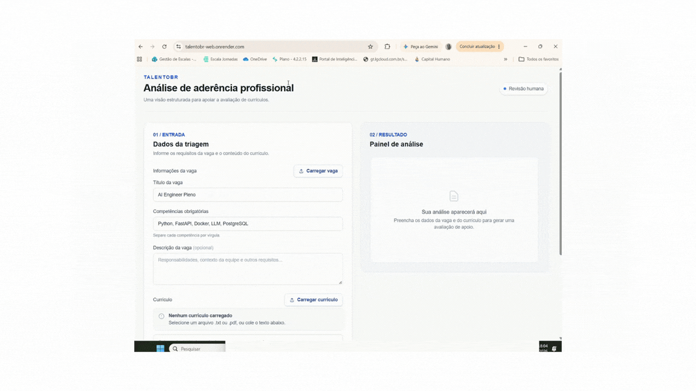

# TalentoBR — CV Screener

[](https://github.com/Barbara-Roberta-Marchinski/ai-factory-talentobr/actions/workflows/ci.yml)
[](https://www.python.org/downloads/)
[](https://opensource.org/licenses/MIT)

Sistema de apoio à triagem de currículos composto por uma API FastAPI e uma interface web Next.js exportada como site estático.

> **Dados de demonstração:** currículos e vagas em `data/` são sintéticos.
> Não use currículos reais antes de implementar e validar os controles de privacidade, segurança, auditoria e conformidade descritos em `docs/`.

## 🚀 Acesso ao Sistema e Demonstração

**URL de Produção:** https://talentobr-web.onrender.com/

*(Coloque aqui uma captura de tela ou GIF demonstrando o sistema em uso)*


## 🎯 Problema e Solução

**O Problema:** O processo de recrutamento tradicional exige que a equipe de RH invista dezenas de horas na triagem manual de currículos, o que gera gargalos operacionais, atrasa o tempo de contratação e resulta em avaliações iniciais sem padronização.

**A Solução:** O TalentoBR reduz o tempo gasto pelo RH na triagem manual, padronizando a avaliação inicial. O sistema automatiza a leitura e a extração de dados, gerando um *score* de aderência da vaga (híbrido entre heurística e LLM). Ele não substitui o recrutador, mas atua como uma ferramenta de apoio para que a equipe foque seu tempo na revisão humana qualificada.

## 🏗️ Arquitetura e Stack Tecnológica

Veja o nosso diagrama detalhado (C4 Model Níveis 1 e 2) e os Registros de Decisão (ADRs) na pasta `docs/`.

**Componentes Principais:**
- **Frontend:** Next.js + Tailwind (exportado como Static Site no Render).
- **Backend (API):** FastAPI (Python) hospedado no Render (`app.py`: `GET /health`, `POST /score`).
- **Engine de IA:** `src/scoring.py` (extração e avaliação com LLM mais score heurístico via OpenAI/Anthropic).
- **Testes & CI/CD:** Pytest (testes offline da API) e GitHub Actions.

O frontend envia o currículo e os dados da vaga diretamente à API. Currículos PDF com camada de texto são extraídos localmente no navegador; OCR ainda não está disponível. Consulte [`talentobr-web/README.md`](./talentobr-web/README.md) para configurar desenvolvimento e deploy no Render.

## ⚙️ Variáveis de Ambiente e Configuração

O projeto utiliza variáveis de ambiente para gerenciar segredos sem expô-los no código-fonte. O arquivo `.env.example` serve como base.

| Variável | Obrigatória? | Exemplo | Descrição |
| :--- | :---: | :--- | :--- |
| `ANTHROPIC_API_KEY` | Sim | `sk-ant-api03...` | Chave de acesso à API do provedor de LLM para gerar o score. |
| `FRONTEND_ORIGINS` | Não | `http://localhost:3000` | URLs permitidas para requisição CORS. Separe por vírgulas. |
| `NEXT_PUBLIC_API_BASE_URL`| Sim (Front) | `http://localhost:8000` | URL onde o Backend (FastAPI) está rodando. |
| `LANGFUSE_PUBLIC_KEY` | Sim (se usar métricas) | `pk-lf-...` | Chave pública para envio de traces ao painel do Langfuse. |
| `LANGFUSE_SECRET_KEY` | Sim (se usar métricas) | `sk-lf-...` | Chave secreta de autenticação do Langfuse. |
| `LANGFUSE_HOST` | Sim (se usar métricas) | `https://us.cloud.langfuse.com` | Host regional exibido nas configurações do projeto Langfuse. |
| `WEBHOOK_ALERTA` | Não (recomendado em produção) | URL do webhook | URL de entrada do workflow do Teams para receber erros da API. |

Configure `WEBHOOK_ALERTA` no ambiente em que a API está executando (por exemplo,
nas variáveis do serviço no Render), não no frontend. O backend envia alertas para
exceções não tratadas, erros HTTP e requisições inválidas (HTTP 422). No Power
Automate, remova condições que filtrem o evento se todos esses erros devem gerar
uma mensagem; uma execução com condição "Falso" termina com êxito, mas não
executa as ações do ramo verdadeiro. O log registra o status HTTP devolvido pelo
workflow.

## 💻 Executar localmente

### Pré-requisitos
- Python 3.11 ou superior
- Node.js 20 ou superior

### API FastAPI

Na raiz do repositório:

```powershell
python -m venv .venv
.\.venv\Scripts\Activate.ps1
pip install -r requirements.txt
Copy-Item .env.example .env
```

Configure a `ANTHROPIC_API_KEY` no seu novo arquivo `.env` e inicie a API:

```powershell
uvicorn app:app --reload
```

A API fica disponível em `http://localhost:8000`. 

### Frontend Next.js

Em outro terminal:

```powershell
Set-Location talentobr-web
npm ci
Copy-Item .env.example .env.local
npm run dev
```

Acesse `http://localhost:3000`.

## 🧪 Testes e build estático

```powershell
# Na raiz: testes offline da API e do scoring
.\.venv\Scripts\pytest.exe -q

# Em talentobr-web: lint e export estático (gera talentobr-web/out/)
npm run lint
npm run build
```

## 📊 Scoring

O score final combina a heurística de skills (40%) e a avaliação LLM (60%). Ele é apenas um insumo para revisão humana e não deve ser usado como decisão automática de contratação.

## 🔄 Evidência de Rollback
Para garantir a resiliência do sistema e cumprir os requisitos de estabilidade, validamos o processo de rollback em produção. Abaixo está a evidência da restauração para uma versão anterior do deploy:
[Evidência Rollback](docs/Evidencia_Rollback.pdf)
 


## ⚠️ Limitações Conhecidas e Dívida Técnica
Este repositório encontra-se na **Fase 2 (Deploy, LGPD e Observabilidade)** e herdou algumas dívidas técnicas do protótipo inicial que foram tratadas e documentadas:
- ~~**LGPD e Dados Pessoais:** O modelo atual não sanitiza PII antes de enviar ao LLM, configurando transferência internacional sem base legal.~~ ✅ **Resolvido:** Função de Regex aplicada obrigatoriamente no backend antes da chamada da IA.
- ~~**Auditoria (Art. 20 LGPD):** As triagens e avaliações do LLM não são rastreáveis.~~ ✅ **Mitigado:** Logs estruturados utilizando Hash Criptográfico (SHA-256) garantem a rastreabilidade sem exposição de dados pessoais.
- **Viés Algorítmico (Ativo):** Testes preliminares do Data Team apontaram tendências de pontuação menor para perfis femininos, candidatos 50+ e regiões fora de capitais. Métricas de *fairness* serão implementadas antes de qualquer operação real com dados autênticos.
- **Aviso de Dados:** Todos os currículos na pasta `data/cvs-exemplos/` são **estritamente sintéticos** e gerados para fins de validação e demonstração.

---

## 🛡️ Dados Pessoais e LGPD (Compliance)
O TalentoBR leva a privacidade a sério e adota práticas rigorosas de DevSecOps e conformidade com a Lei Geral de Proteção de Dados (LGPD):
- **Sanitização de PII (Art. 33):** Antes de qualquer dado ser enviado aos provedores de LLM externos (Anthropic/OpenAI nos EUA), o sistema executa uma limpeza obrigatória via Expressões Regulares (Regex), mascarando identificadores duros (CPF, Telefones, E-mails e URLs). Isso mitiga imediatamente o risco de transferência internacional de dados sensíveis.
- **Governança e Política de Retenção:** Os currículos avaliados possuem retenção máxima de 6 meses (ciclo da vaga). O expurgo físico é realizado por um mecanismo real de varredura automatizada (script `scripts/limpeza_retencao.py`), garantindo a exclusão irreversível após o tempo de guarda estabelecido.
- **Mapa de Dados e Bases Legais:** A justificativa legal para coleta (Execução de Contrato e Legítimo Interesse) e o fluxo de vida útil dos dados estão exaustivamente auditados e documentados internamente em nossa [Política de Governança, Ética e LGPD](docs/governanca-etica-e-lgpd.md).

## 👁️ Observabilidade e Segurança
- **Logs Seguros e Anonimizados:** Para garantir a coleta de métricas (volume, erros, latência) sem expor informações pessoais dos candidatos, nossos logs no backend utilizam um **hash criptográfico (SHA-256)** gerado a partir do currículo. Dados sensíveis nunca são impressos no terminal ou nos logs da nuvem.
- **Segurança de Credenciais:** As chaves de API nunca são escritas diretamente no código ("hardcoded"). Se uma falha ou scanner (`gitleaks`) detectar a exposição de um token, nossa política de resposta a incidentes exige a imediata revogação no painel do provedor da API e a emissão de uma nova credencial.
- **Métricas e Alertas (Langfuse)**
Nossa aplicação está instrumentada com o SDK v5 do Langfuse (via OpenTelemetry), capturando Traces e Spans que cobrem o fluxo real do sistema (da API ao LLM) em produção no Render.

🎯 5 Métricas Essenciais e Thresholds
Definimos métricas de negócio e performance para garantir a resiliência e a viabilidade do projeto:

Latência (p50, p95, p99)

Threshold: p95 < 4,0s para requisições novas (Cache Miss) e p99 < 0,5s para requisições em cache (Cache Hit).

Justificativa: Garantir UX fluida no frontend. Testes atuais demonstram processamento do LLM (Claude Haiku) em ~2,44s (dentro do limite) e retornos de cache em ~0,00s.

Custo ($) e Consumo de Tokens

Threshold: Alerta se o custo médio por análise exceder $ 0.05.

Justificativa: Manter a viabilidade financeira do projeto. O sistema de Cache implementado evita chamadas redundantes, baixando o custo de reanálise para $ 0.00.

Taxa de Erro (HTTP 500 / JSON Parse)

Threshold: < 1% de falhas nas chamadas do modelo.

Justificativa: O pipeline de avaliação matemática depende estritamente de um retorno JSON válido pelo LLM. Falhas quebram a interface do recrutador.

Volume (Tráfego de Requisições)

Threshold: Pico > 100 requisições/minuto.

Justificativa: Prevenir ataques de exaustão (DDoS) no endpoint de score ou comportamento abusivo de bots que possam estourar a cota da Anthropic.

Qualidade (Discrepância Heurística vs. LLM)

Threshold: Variação maior que 40 pontos entre score_heuristico e score_llm.

Justificativa: Monitorar alucinações da IA ou regras determinísticas demasiadamente rígidas. Serve como termômetro para calibração dos pesos.

🚨 Alerta Funcional Configurado
Implementamos monitoramento crítico de disponibilidade da engine de IA:

Gatilho (Regra): Exceção ou Timeout não tratado na função de comunicação (_chamar_llm) da API.

Prioridade: P1 (Crítica) - Sistema de triagem indisponível.

Público-alvo: Equipe de SRE (Engenharia de Confiabilidade) e Desenvolvedores Backend.

Canal: Disparo estruturado via logger no Console do Render (passível de integração via webhook para Slack #alertas-producao ou PagerDuty).

📊 Dashboard Curado em Produção
O painel abaixo comprova a instrumentação online com capturas reais das triagens realizadas.(https://us.cloud.langfuse.com/project/cmvokcfwy025gad0jzimbl0wh/traces)

Evidências do Langfuse:Os painéis demonstram a saúde da aplicação com 24 observações capturadas, p95 de latência mantendo-se na margem de 2.32s, e o sucesso do cache (latência zero) garantindo o funcionamento esperado.

## 🛠️ Troubleshooting (Resolução de Problemas Comuns)
- **Erro de CORS no Frontend (Next.js vs FastAPI):** Se a interface web falhar ao conectar com o backend, verifique se a variável `FRONTEND_ORIGINS` no painel do Render contém a URL pública e exata do frontend, **sem a barra (/) no final** do domínio.
- **Erro HTTP 401 ou Timeout da Inteligência Artificial:** Isso geralmente significa que a variável de ambiente `ANTHROPIC_API_KEY` expirou, foi revogada por segurança ou está incorreta. Acesse o painel da Anthropic, gere uma nova chave, atualize no seu `.env` (ou no Render) e reinicie a aplicação.
- **Currículo não extrai texto (Retorna Vazio ou com Score 0):** Como o sistema ainda não possui uma engine nativa de OCR (Reconhecimento Óptico de Caracteres), certifique-se de que o PDF enviado não é um "documento escaneado como imagem", mas sim um arquivo com camada de texto digitalmente selecionável.

## 📄 Licença
Distribuído sob a licença MIT.